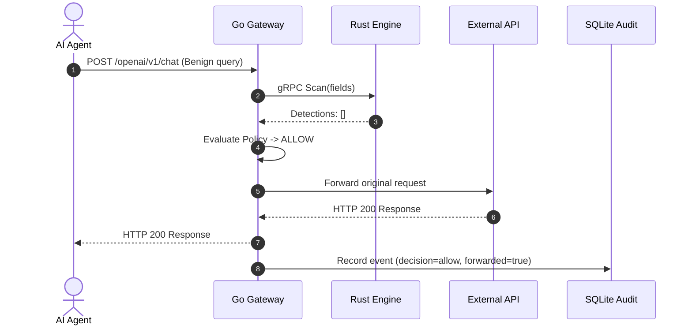
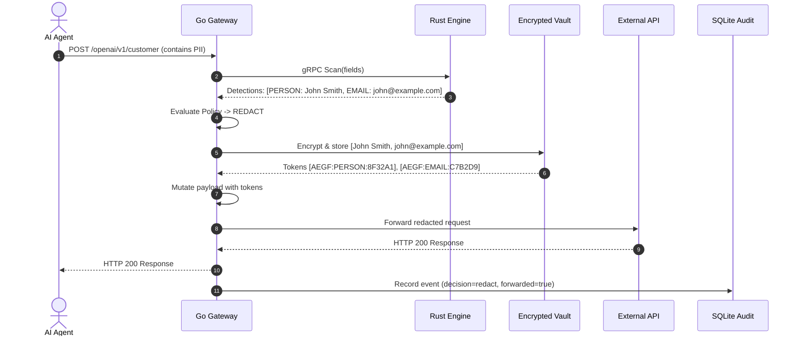
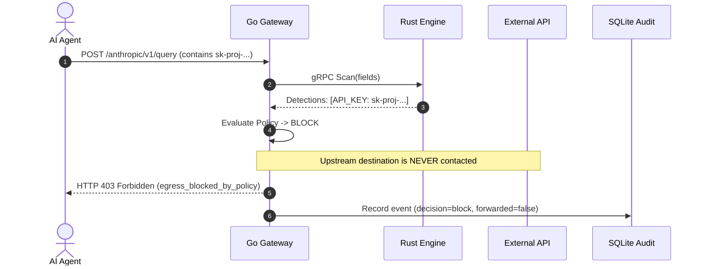
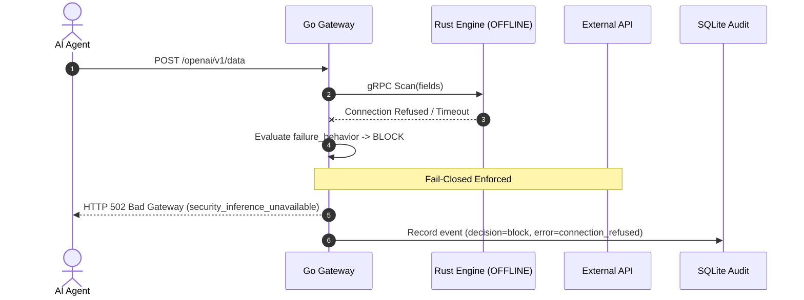
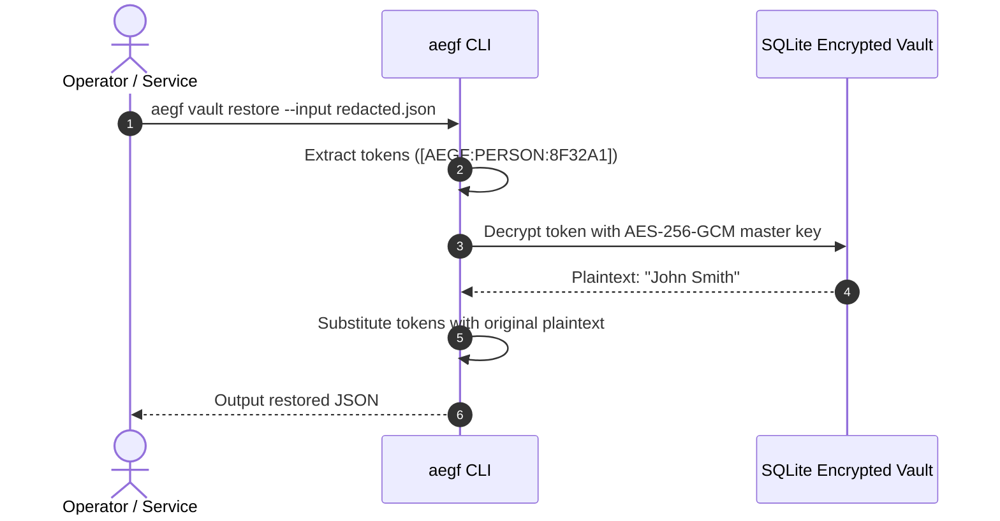

# `agent-egress-firewall` (`aegf`)

**Self-Hosted Egress Security Proxy for AI Agents, Backend Services, and LLM Workflows**

[](./LICENSE)
[](https://go.dev/)
[](https://www.rust-lang.org/)
[](https://onnxruntime.ai/)

`agent-egress-firewall` (`aegf`) is a self-hosted security proxy that inspects outbound HTTP requests originating from autonomous AI agents, backend microservices, and applications. It identifies confidential data, API credentials, and PII locally using zero-shot GLiNER ONNX models and deterministic pattern detectors, enforcing security policies to **allow**, **redact**, or **block** requests before they leave your infrastructure.

---

## Why Outbound Data Inspection Matters

Autonomous AI agents and LLM applications make extensive external API calls. Without egress inspection, systems are vulnerable to:

- **Unintentional Data Exfiltration:** Agents passing user PII, database dumps, or customer contact records into third-party AI prompts.
- **Accidental Credential Leakage:** Hardcoded API keys, JWT bearer tokens, or cloud secrets inadvertently pasted into chat contexts.
- **Compliance Violations:** Transmitting regulated financial or healthcare records (GDPR, HIPAA, PCI-DSS) across international boundaries.

`aegf` acts as an egress security gateway positioned between your application layer and external APIs (OpenAI, Anthropic, third-party SaaS), verifying every request locally without sending your data to external classification services.

---

## Architecture Overview

```mermaid
graph TD
    Client[Application / AI Agent] -->|Outbound HTTP Request| Proxy[Go Gateway Proxy :8080]
    Proxy -->|Route Match & Size Limits| Extractor[Content Extractor]
    Extractor -->|gRPC ScanRequest| RustEngine[Rust Detection Engine :50051]

    subgraph Rust Detection Engine
        RustEngine --> GLiNER[GLiNER ONNX Model]
        RustEngine --> Patterns[Regex & Luhn Detectors]
        GLiNER --> Resolver[Conflict & Span Resolver]
        Patterns --> Resolver
    end

    Resolver -->|Normalized Findings| Proxy
    Proxy -->|Evaluate Policy| PolicyEngine[Go Policy Engine]

    PolicyEngine -->|ALLOW| Upstream[External API / OpenAI / Anthropic]
    PolicyEngine -->|BLOCK| Reject[403 Forbidden Response]
    PolicyEngine -->|REDACT| Vault[Encrypted Vault (AES-256-GCM)]
    Vault -->|Mutated Request| Upstream

    Proxy -->|Audit Log| AuditDB[(SQLite Audit Store)]
    Upstream -->|Streaming SSE / Chunks| Client
```

### Clean Separation of Concerns

- **Go owns Enforcement:** HTTP networking, routing, route prefix stripping, body mutation, policy evaluation, AES-256-GCM vault persistence, audit logging, and Prometheus metrics.
- **Rust owns Detection:** GLiNER ONNX zero-shot model inference, dynamic label conditioning, word tokenization, deterministic regex matching, credit card Luhn validation, and Unicode character span resolution.

---

## Sequence Diagrams

### 1. Allowed Request



### 2. Redacted Request & Vault Persistence



### 3. Blocked Request (API Credential)



### 4. Inference Engine Failure (Fail-Closed)



### 5. Privileged Vault Restoration



---

## Detection Capabilities & Benchmark Results

AEGF combines local GLiNER ONNX inference with algorithmic pattern detectors:

| Detector         | Category          | Engine      | Verification                             |
| ---------------- | ----------------- | ----------- | ---------------------------------------- |
| Person Names     | `PERSON`          | GLiNER ONNX | Zero-shot multilingual span extraction   |
| Email Addresses  | `EMAIL`           | Pattern     | RFC-5322 regex validation                |
| Phone Numbers    | `PHONE`           | Pattern     | International E.164 and national formats |
| Credit Cards     | `ACCOUNT_NUMBER`  | Pattern     | Regex + **Luhn Algorithm (MOD 10)**      |
| API Keys         | `API_KEY`         | Pattern     | OpenAI, Anthropic, GitHub, AWS, Slack    |
| Private Keys     | `PRIVATE_KEY`     | Pattern     | RSA, EC, DSA, OpenSSH, PGP PEM headers   |
| Secrets & JWTs   | `INTERNAL_SECRET` | Pattern     | 3-part Base64url JWT + hex secret tokens |
| Dynamic Patterns | User-Defined      | Pattern     | Safe runtime regex compiled dynamically  |

### Benchmark Quality Evaluation (Run via `make eval`)

Evaluated on synthetic multilingual dataset (`tests/fixtures/eval_dataset.json`):

```text
======================================================
 EVALUATION REPORT: COMBINED (GLiNER + Patterns)
======================================================
OVERALL METRICS:
  Precision: 1.000 (15 TP, 0 FP)
  Recall:    0.833 (15 TP, 3 FN)
  F1 Score:  0.909

BY CATEGORY:
  Category             Prec     Recall   F1       TP/FP/FN
  --------------------------------------------------------
  PERSON               1.00     0.50     0.67     3/0/3
  EMAIL                1.00     1.00     1.00     6/0/0
  INTERNAL_PROJECT     1.00     1.00     1.00     1/0/0
  ACCOUNT_NUMBER       1.00     1.00     1.00     1/0/0
  API_KEY              1.00     1.00     1.00     2/0/0
  PHONE                1.00     1.00     1.00     1/0/0
  NETWORK_IDENTIFIER   1.00     1.00     1.00     1/0/0

BY LANGUAGE:
  en: F1 = 0.95 | es: F1 = 1.00 | fr: F1 = 1.00 | de: F1 = 0.67 | ar: F1 = 0.67
```

---

## Quickstart

### Prerequisites

- Go 1.24+
- Rust 1.85+ and Cargo
- Python 3 (for downloading model weights)

### 1. Build Binaries

```bash
make build
```

This compiles:

- `bin/aegf` (Go Gateway & CLI)
- `bin/aegf-inference` (Rust Detection & ONNX Engine)

### 2. Download Model Assets

```bash
make models
```

Downloads `model_quantized.onnx`, `tokenizer.json`, and `gliner_config.json` into `models/gliner-small/`.

### 3. Run Preflight Diagnostics

```bash
./bin/aegf doctor --config configs/config.example.yaml
```

Verifies config, Go runtime, SQLite permissions, vault key, model weights, and gRPC readiness.

### 4. Run the Complete End-to-End Demo

```bash
./scripts/demo.sh
```

Demonstrates all scenarios (allowed, redacted, blocked, dynamic categories, audit inspection, and vault restoration).

---

## CLI Reference (`aegf`)

```text
aegf <command> [flags]

Commands:
  serve              Start the proxy gateway and operational endpoints
  doctor             Run preflight diagnostics across dependencies and configuration
  version            Print application version
  scan               Scan text or file without proxying (supports stdin)
  config validate    Validate firewall configuration and security policies
  policy test        Evaluate a sample payload against a selected security policy
  audit list         Query request audit trail records
  vault list         List encrypted redaction records for a request ID
  vault inspect      Inspect a redaction vault record metadata by token
  vault restore      Restore vaulted redactions in a file or stdin to original content
  vault purge        Purge vault records older than specified duration
  models list        List installed model assets and status
  models fetch       Download default model assets (GLiNER ONNX)
  models verify      Verify model integrity and engine compatibility
```

### Examples

**Scan a file or pipe:**

```bash
echo "Contact John Smith at john@example.com" | aegf scan
```

**Test a request against a security policy:**

```bash
aegf policy test --policy strict-ai-egress --input examples/requests/customer.json
```

**Query the audit trail:**

```bash
aegf audit list --route openai --limit 10
```

**Restore redacted text from the encrypted vault:**

```bash
aegf vault restore --input response.json --output restored.json
```

---

## Operational Endpoints

The gateway exposes standard operational endpoints:

- `GET /health`: Liveness probe. Returns HTTP 200 `{ "status": "healthy" }`.
- `GET /ready`: Readiness probe. Returns HTTP 200 if config and inference engine are connected.
- `GET /metrics`: Prometheus metrics covering request counts, latencies, and detections by category.

---

## Documentation

Comprehensive architecture, operational, and security guides are available in the [docs/](./docs) directory:

- [Architecture & Protocol Buffers](./docs/architecture.md)
- [Configuration Reference](./docs/configuration.md)
- [Detection Engine & ML Taxonomy](./docs/detection.md)
- [Policy Engine & Precedence Rules](./docs/policies.md)
- [Encrypted Redaction Vault](./docs/redaction-vault.md)
- [Deployment, Docker & Kubernetes](./docs/deployment.md)
- [Security Model & Guarantees](./docs/security-model.md)
- [Troubleshooting & Runbook](./docs/troubleshooting.md)
- [Security Policy & Disclosures](./SECURITY.md)

---

## Contributing

We welcome community contributions! Please review our [Contributing Guidelines](./CONTRIBUTING.md) and [Code of Conduct](./CODE_OF_CONDUCT.md) before submitting pull requests.

---

## License

This project is licensed under the [MIT License](./LICENSE).
