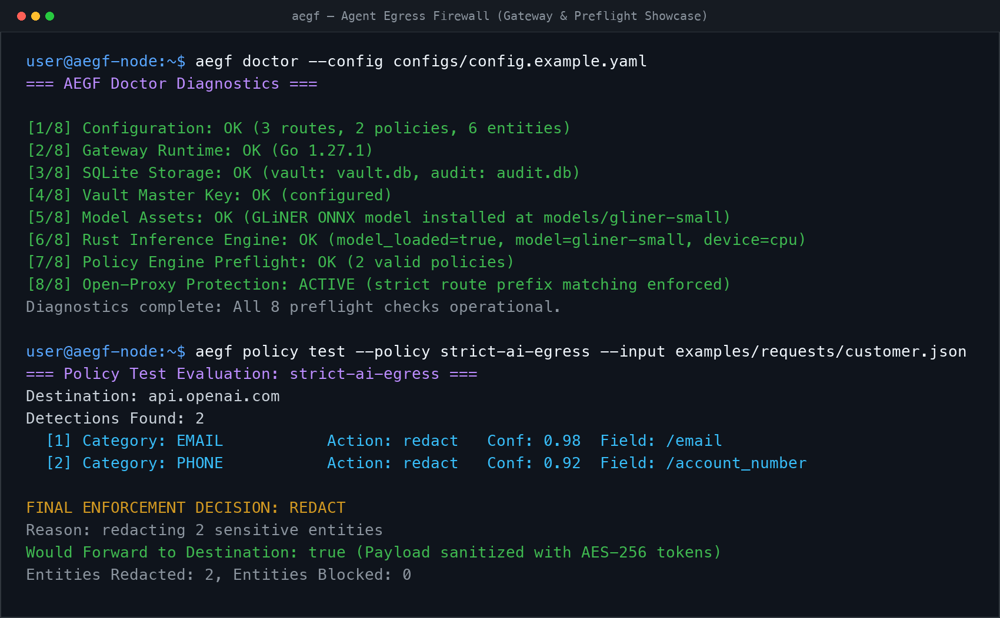
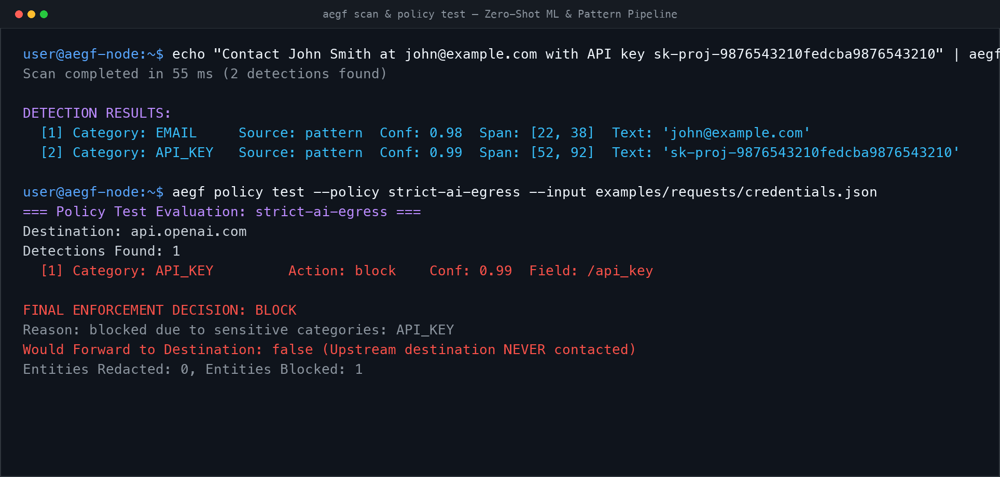
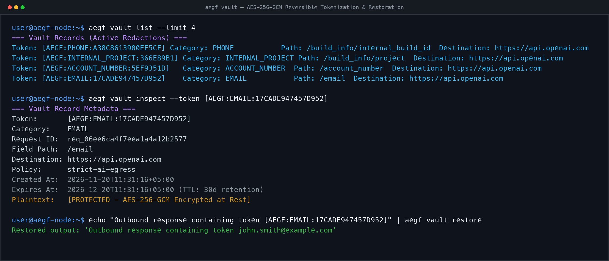
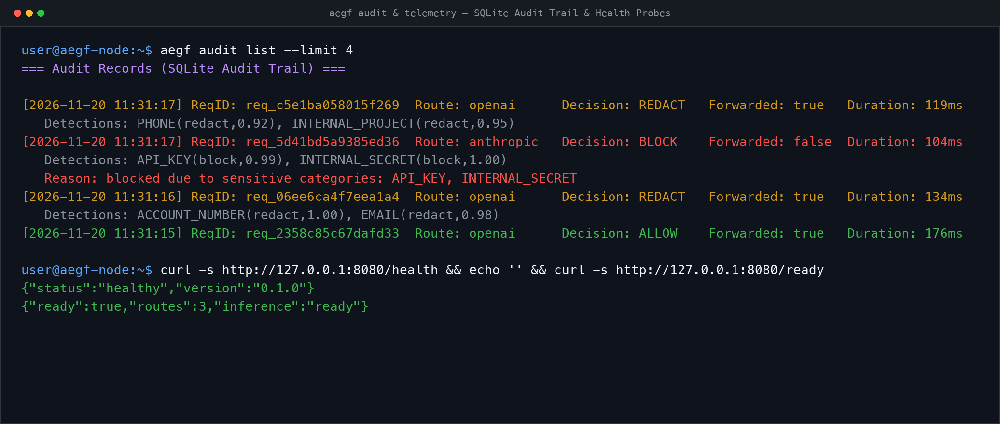
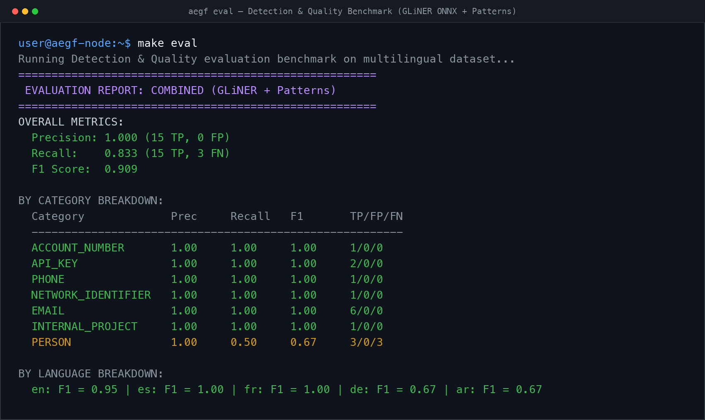
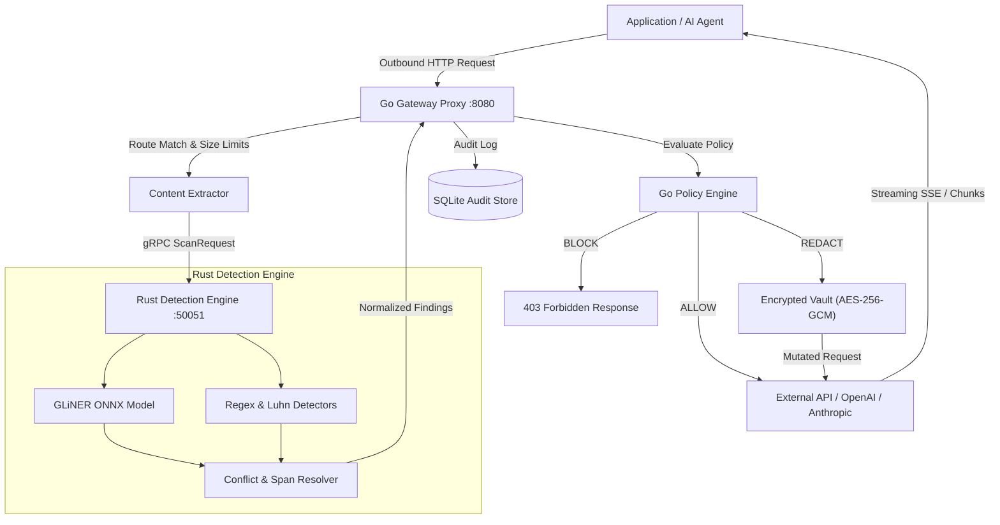
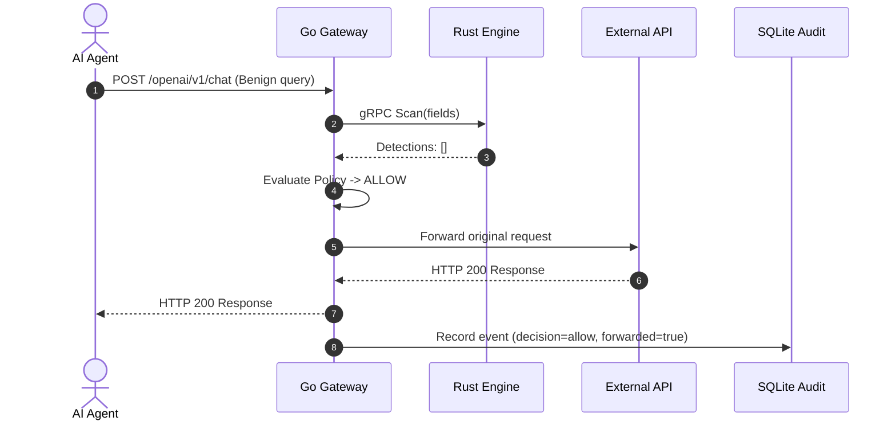
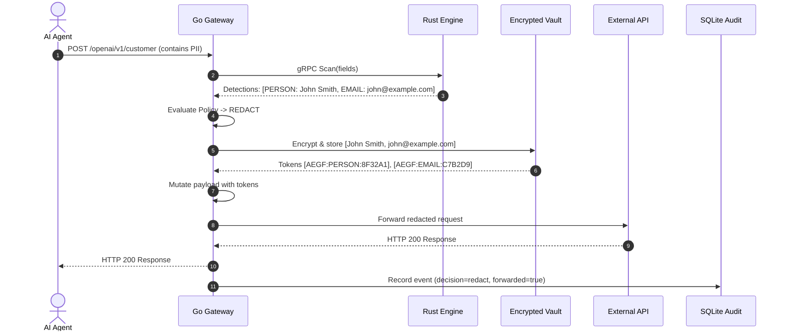
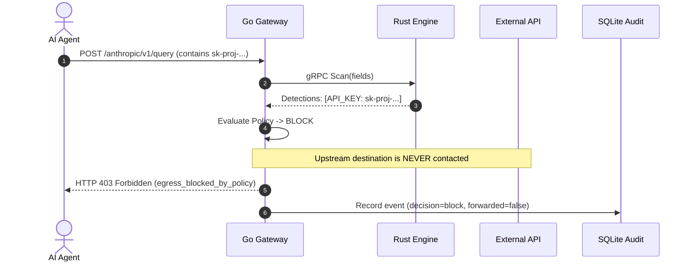
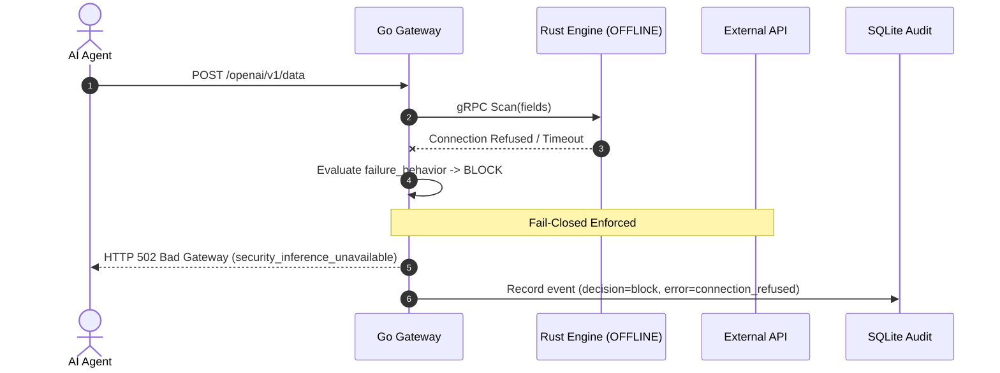

# `agent-egress-firewall` (`aegf`)

**Self-Hosted Egress Security Proxy for AI Agents, Backend Services, and LLM Workflows**

[](./LICENSE)
[](https://go.dev/)
[](https://www.rust-lang.org/)
[](https://onnxruntime.ai/)
[](https://github.com/ranajahanzaib/agent-egress-firewall/actions)

`agent-egress-firewall` (`aegf`) is a self-hosted security gateway proxy that inspects outbound HTTP requests originating from autonomous AI agents, backend microservices, and LLM applications. It identifies confidential data, API credentials, and PII locally using zero-shot GLiNER ONNX models and deterministic pattern detectors, enforcing security policies to **allow**, **redact**, or **block** requests before they ever leave your infrastructure.



---

## Why Outbound Data Inspection Matters

Autonomous AI agents and LLM applications make extensive outbound API calls to third-party endpoints. Without egress traffic inspection, systems are vulnerable to:

- **Unintentional Data Exfiltration:** Agents passing customer PII, database dumps, internal project names, or contact records into third-party AI prompts.
- **Accidental Credential Leakage:** Hardcoded API keys, JWT bearer tokens, SSH keys, or cloud secrets inadvertently pasted into chat contexts.
- **Compliance Violations:** Transmitting regulated financial or healthcare records (GDPR, HIPAA, PCI-DSS) across international boundaries without cryptographic redaction.

`aegf` acts as an egress security gateway positioned between your application layer and external APIs (OpenAI, Anthropic, third-party SaaS), verifying every request locally without sending your data to external classification services.

---

## Visual Showcase & Feature Walkthrough

### 1. Preflight Diagnostics & Policy Testing

Verify system readiness, Go/Rust runtimes, ONNX model weights, SQLite databases, and security policies in a single command, then dry-run security policy enforcement on sample payloads.


### 2. Zero-Shot Entity Inspection & CLI Scanning

Inspect arbitrary text, JSON bodies, or piped stdin without proxying. Combines GLiNER ONNX deep-learning span extraction with deterministic regex and Luhn algorithm validators.



### 3. Encrypted Redaction Vault (AES-256-GCM)

Sensitive data is replaced with deterministic, unpredictable tokens (e.g. `[AEGF:EMAIL:17CADE947457D952]`) and persisted into an AES-256-GCM encrypted SQLite vault. Privileged downstream services can restore tokens in-place back to plaintext.



### 4. Immutable SQLite Audit Trail & Health Telemetry

Every outbound request, policy decision (`ALLOW`, `REDACT`, `BLOCK`), detection breakdown, and latency metric is recorded into an audit database and exported via Prometheus.



### 5. Detection & Quality Benchmark (`make eval`)

Rigorous evaluation against synthetic multilingual datasets measuring precision, recall, and F1 scores across individual entity categories and languages.



---

## Key Features

- **Hybrid Detection Engine:** Combines local zero-shot GLiNER ONNX inference (for contextual entities like person names) with deterministic regex, Luhn algorithm check, and PEM key header detectors.
- **Zero-Cloud-Dependency Scanning:** Runs 100% locally on CPU or Apple Silicon/CUDA via ONNX Runtime without sending classification data to third parties.
- **Encrypted Reversible Redaction Vault:** Uses AES-256-GCM to persist sensitive values mapped to opaque tokens. Downstream workflows can restore original values when authorized.
- **Strict Policy Engine:** Configurable route-based security policies supporting granular actions (`allow`, `redact`, `block`), confidence thresholds, and destination exception rules.
- **Fail-Closed Resilience:** Configurable operational failure behaviors (`inference_unavailable`, `timeout`, `malformed_payload`, `oversized_payload`) default to fail-closed (`block`) to guarantee data safety.
- **Comprehensive Audit Trail & Metrics:** Built-in SQLite audit store tracking all inspected requests, detected entities, latency, and enforcement outcomes, paired with Prometheus `/metrics`.
- **Open-Proxy Prevention:** Strict route prefix matching ensures the proxy cannot be abused as an arbitrary open egress tunnel.

---

## Architecture Overview



### Clean Separation of Concerns

- **Go owns Enforcement:** HTTP networking, routing, route prefix stripping, body mutation, policy evaluation, AES-256-GCM vault persistence, audit logging, and Prometheus metrics.
- **Rust owns Detection:** GLiNER ONNX zero-shot model inference, dynamic label conditioning, word tokenization, deterministic regex matching, credit card Luhn validation, and Unicode character span resolution.

---

## Sequence Diagrams

### 1. Allowed Request



### 2. Redacted Request & Vault Persistence



### 3. Blocked Request (API Credential)



### 4. Inference Engine Failure (Fail-Closed)



---

## Detection Capabilities & Benchmark Results

AEGF combines local GLiNER ONNX inference with algorithmic pattern detectors:

| Detector         | Category          | Engine      | Verification                             |
| ---------------- | ----------------- | ----------- | ---------------------------------------- |
| Person Names     | `PERSON`          | GLiNER ONNX | Zero-shot multilingual span extraction   |
| Email Addresses  | `EMAIL`           | Pattern     | RFC-5322 regex validation                |
| Phone Numbers    | `PHONE`           | Pattern     | International E.164 and national formats |
| Credit Cards     | `ACCOUNT_NUMBER`  | Pattern     | Regex + **Luhn Algorithm (MOD 10)**      |
| API Keys         | `API_KEY`         | Pattern     | OpenAI, Anthropic, GitHub, AWS, Slack    |
| Private Keys     | `PRIVATE_KEY`     | Pattern     | RSA, EC, DSA, OpenSSH, PGP PEM headers   |
| Secrets & JWTs   | `INTERNAL_SECRET` | Pattern     | 3-part Base64url JWT + hex secret tokens |
| Dynamic Patterns | User-Defined      | Pattern     | Safe runtime regex compiled dynamically  |

### Benchmark Quality Evaluation (Run via `make eval`)

Evaluated on synthetic multilingual benchmark callset (`tests/fixtures/eval_dataset.json`):

```text
======================================================
 EVALUATION REPORT: COMBINED (GLiNER + Patterns)
======================================================
OVERALL METRICS:
  Precision: 1.000 (15 TP, 0 FP)
  Recall:    0.833 (15 TP, 3 FN)
  F1 Score:  0.909

BY CATEGORY BREAKDOWN:
  Category             Prec     Recall   F1       TP/FP/FN
  --------------------------------------------------------
  ACCOUNT_NUMBER       1.00     1.00     1.00     1/0/0
  API_KEY              1.00     1.00     1.00     2/0/0
  PHONE                1.00     1.00     1.00     1/0/0
  NETWORK_IDENTIFIER   1.00     1.00     1.00     1/0/0
  EMAIL                1.00     1.00     1.00     6/0/0
  INTERNAL_PROJECT     1.00     1.00     1.00     1/0/0
  PERSON               1.00     0.50     0.67     3/0/3

BY LANGUAGE BREAKDOWN:
  en: F1 = 0.95 | es: F1 = 1.00 | fr: F1 = 1.00 | de: F1 = 0.67 | ar: F1 = 0.67
```

---

## Quickstart

### Prerequisites

- **Go 1.24+**
- **Rust 1.92+** and **Cargo**
- **Python 3** (for fetching GLiNER ONNX weights from Hugging Face)

### 1. Build Binaries

```bash
make build
```

Compiles:

- `bin/aegf` (Go Gateway & CLI)
- `bin/aegf-inference` (Rust Detection & ONNX Inference Engine)

### 2. Download Model Assets

```bash
make models
# Or via CLI:
./bin/aegf models fetch
```

Downloads `model_quantized.onnx`, `tokenizer.json`, and `gliner_config.json` into `models/gliner-small/`.

### 3. Run Preflight Diagnostics

```bash
./bin/aegf doctor --config configs/config.example.yaml
```

Verifies configuration integrity, Go runtime, SQLite storage, master key, model weights, Rust gRPC connectivity, and open-proxy safeguards.

### 4. Run the End-to-End Demonstration

```bash
make run
# Or directly:
./scripts/demo.sh
```

Executes a full lifecycle demo demonstrating allowed queries, PII redaction and token vaulting, API credential blocking, dynamic category enforcement, audit querying, and reverse vault restoration.

---

## CLI Reference (`aegf`)

```text
aegf <command> [flags]

Commands:
  serve              Start the proxy gateway and operational endpoints
  doctor             Run preflight diagnostics across dependencies and configuration
  version            Print application and Go runtime versions
  scan               Scan text or file without proxying (supports stdin)
  config validate    Validate firewall configuration and security policies
  policy test        Evaluate a sample payload against a selected security policy
  audit list         Query request audit trail records
  vault list         List encrypted redaction records for a request ID
  vault inspect      Inspect a redaction vault record metadata by token
  vault restore      Restore vaulted redactions in a file or stdin to original content
  vault purge        Purge vault records older than specified duration
  models list        List installed model assets and status
  models fetch       Download default model assets (GLiNER ONNX)
  models verify      Verify model integrity and engine compatibility
```

### Common Usage Examples

**Scan text or stdin directly:**

```bash
echo "Contact John Smith at john@example.com with API key sk-proj-1234567890abcdef" | aegf scan
```

**Evaluate a JSON payload against a policy:**

```bash
aegf policy test --policy strict-ai-egress --input examples/requests/customer.json
```

**Query the SQLite audit log:**

```bash
aegf audit list --route openai --limit 10
```

**Restore redacted tokens from the encrypted vault:**

```bash
echo "Response payload with [AEGF:EMAIL:17CADE947457D952]" | aegf vault restore
```

---

## Operational Endpoints

The Go gateway exposes standard operational probes:

- `GET /health`: Liveness probe. Returns HTTP 200 `{ "status": "healthy", "version": "0.1.0" }`.
- `GET /ready`: Readiness probe. Returns HTTP 200 if config and inference engine are connected and operational.
- `GET /metrics`: Prometheus metrics exposing request counts by route and decision, detection counts by category and detector, inference duration, and active proxy connections.

---

## Running the Test Suite

```bash
# Run all unit tests (Go and Rust)
make test

# Run Go unit tests across all packages
go test -v ./internal/...

# Run Rust inference unit tests
cd inference && cargo test

# Run End-to-End integration test suite
go test -v -race ./tests/integration/...

# Run linters and code formatting
make lint
make fmt
```

---

## Documentation Directory

Comprehensive technical guides and specifications are available in [docs/](./docs):

- [Architecture & Protocol Buffers](./docs/architecture.md)
- [Configuration Reference](./docs/configuration.md)
- [Detection Engine & ML Taxonomy](./docs/detection.md)
- [Policy Engine & Precedence Rules](./docs/policies.md)
- [Encrypted Redaction Vault](./docs/redaction-vault.md)
- [Deployment, Docker & Kubernetes](./docs/deployment.md)
- [Security Model & Guarantees](./docs/security-model.md)
- [Troubleshooting & Runbook](./docs/troubleshooting.md)
- [Security Policy & Disclosures](./SECURITY.md)

---

## Contributing

We welcome contributions! Please review our [Contributing Guidelines](./CONTRIBUTING.md) and [Code of Conduct](./CODE_OF_CONDUCT.md) before opening a pull request.

---

## License & Custom Work

[](mailto:work@withrana.com) [](https://www.linkedin.com/in/workwithrana)
[](https://www.upwork.com/freelancers/~01bbcf6edb91a8df5f)
[](https://contra.com/ranajahanzaib/)

**License:** MIT, see [LICENSE](LICENSE). Free for personal and commercial use.

**Author:** Rana Jahanzaib

**Need this built for your stack?** Email me what you're working on: work@withrana.com
